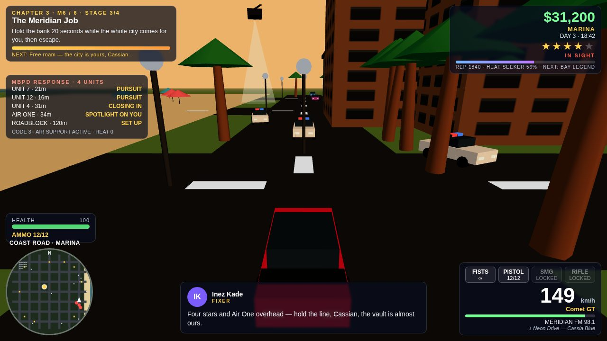
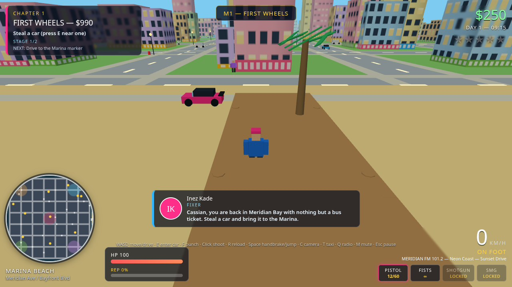
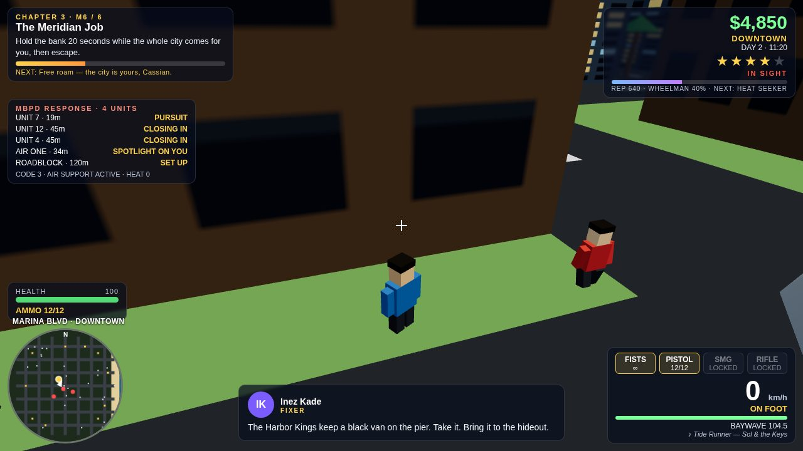
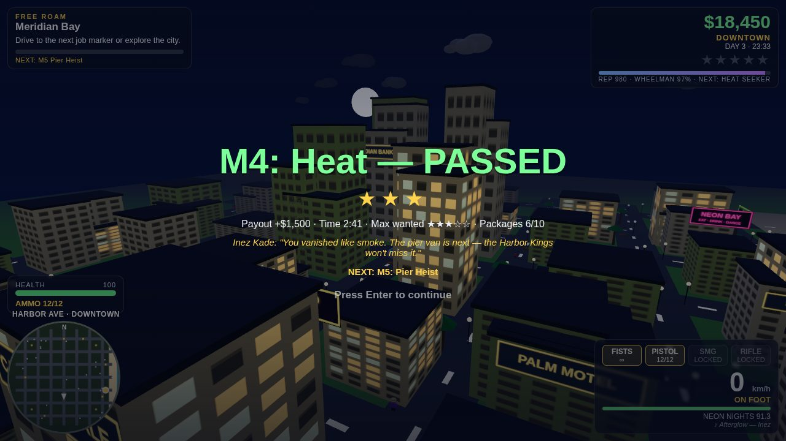

# MERIDIAN BAY

[](https://make.fun/bounty/gta6-01?utm_source=github&utm_medium=readme&utm_campaign=gta6-01)
[](https://make.fun/bounty/gta6-01/leaderboard?utm_source=github&utm_medium=readme&utm_campaign=gta6-01)
[](https://make.fun/bounty/gta6-01?utm_source=github&utm_medium=readme&utm_campaign=gta6-01)

Bounty: [gta6-01 on make.fun](https://make.fun/bounty/gta6-01)

A Grand Theft Auto VI style open-world crime game, built for the make.fun
gta6-01 bounty. Three.js, static files only — no build step, no network.

## The game

Cassian Rowe is new in Meridian Bay: broke, carless, and already on the
MBPD's list. His fixer **Inez Kade** has six jobs for him, from stealing his
first wheels to **The Meridian Job** — a bank hit with the whole city in
pursuit. The city is a 7x7 coastal grid with a beach, a pier, a lighthouse,
traffic, pedestrians, taxi fares, hidden packages, combat, a wanted system
with cruisers, foot cops and the AIR ONE helicopter, and a live minimap.

- **Open world** — drive or walk anywhere: 7x7 blocks, beach, pier, plaza
- **Stealable cars** — 7 classes, including the hot-pink Comet GT
- **Wanted 0–5 stars** — MBPD cruisers chase and ram, foot cops at low heat,
  AIR ONE helicopter with a spotlight at 3+ stars
- **6 story missions** — First Wheels, Courier Run, The Pickup, Heat,
  Pier Heist, The Meridian Job
- **Combat** — punch and pistol, Harbor Kings gunmen, health + REP
- **HUD** — mission panel, wanted stars, money, day/clock, district + street,
  police panel with named units, circular live minimap, weapon slots
- **Save** — progress saves locally in the browser

## Controls

| Key | Action |
| --- | --- |
| WASD / arrows | Move / drive |
| Mouse drag | Orbit camera |
| E | Steal car / exit car |
| Click | Shoot pistol |
| F | Punch |
| 1 / 2 | Fists / pistol |
| Space | Jump (on foot) / handbrake (driving) |
| Shift | Run |
| V | Change radio station |
| M | Mute |
| P | Pause (saves) |

## Run it

```bash
node serve.ts            # serves game/ at http://127.0.0.1:8080/
node render-shots.mjs    # takes the 4 dossier screenshots
```

Deterministic screenshot scenes (seeded): `?shot=chase|foot|dialog|mission&seed=1`.

## Screenshots






## Original IP

Meridian Bay, Cassian Rowe, Inez Kade, the MBPD and the Harbor Kings are
original characters and places created for this entry. Not affiliated with
Rockstar Games.
